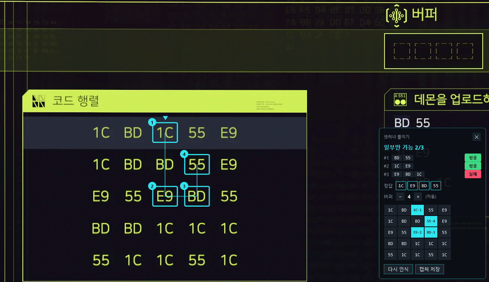

<div align="center">


# cyberpunk-netrunner-solver

**Cyberpunk 2077 브리치 프로토콜 해결 도구**<br>단축키 한 번으로 화면을 읽어 게임 화면 위에 풀이 경로를 표시하는 Windows 오버레이 프로그램


[받기](#받기) · [쓰는 법](#쓰는-법) · [로드맵](#로드맵) · [문서](#문서) · [English](#english)



</div>

> [!NOTE]
> 이 프로그램은 CD PROJEKT RED와 관계없는 비공식 팬 도구입니다. 게임 파일과 메모리를 건드리지 않고 화면만 읽으며 자동으로 클릭하지 않습니다.

## 특징

- **단축키 한 번으로 즉시 풀이합니다.** 기본 단축키(백틱 + Space)를 누르면 포그라운드 창이 있는 화면을 캡처하고 퍼즐을 인식하여 최적의 경로를 찾아냅니다.
- **게임 화면 위에 직접 번호와 선을 그립니다.** 게임의 코드 행렬 칸 위에 고를 순서 번호와 이동 경로 선을 오버레이로 표시합니다.
- **게임 언어와 상관없이 다국어 인식이 가능합니다.** Windows에 설치된 문자 인식 언어를 모두 동시에 활용해 코드 값만 추출하므로 게임 언어 설정에 구애받지 않습니다.
- **인식 실패와 마우스 커서 가림을 즉시 알립니다.** 못 읽은 칸은 ?로 드러내며, 마우스 커서가 코드를 가리면 실패로 알리고 경로를 그리지 않습니다.
- **패널에서 칸을 직접 수정하고 버퍼 크기를 조절합니다.** 잘못 인식된 칸이나 시퀀스를 클릭하여 코드를 바꾸고 버퍼 크기 버튼으로 길이를 맞출 수 있습니다.

## 로드맵

- [x] 행렬·시퀀스·버퍼 자동 인식
- [x] 다국어 문자 인식
- [x] 마우스 커서 가림 안내
- [x] 단축키 바꾸기와 한국어·영어 화면
- [ ] Windows 시작 시 자동 실행
- [ ] 이미 고른 칸이 있을 때 이어 풀기
- [ ] 실행 파일 크기 줄이기
- [ ] 공개 릴리스

## 받기

| 판 | 필요한 것 |
| --- | --- |
| `publish/self-contained`의 exe | 따로 설치할 것 없음 |
| `publish/framework-dependent`의 exe | .NET 10 데스크톱 런타임 |

공통으로 Windows 10 2004(19041) 이상 또는 Windows 11이 필요합니다.

직접 빌드할 때는 저장소 루트에서 아래 명령을 실행합니다.

```bash
# publish/framework-dependent 및 publish/self-contained에 단일 exe 생성
./publish.sh
```

## 쓰는 법

1. 프로그램을 실행하면 시스템 트레이에 상주합니다.
2. 게임에서 브리치 프로토콜 화면을 엽니다.
3. 백틱(`) + Space를 누릅니다.
4. 화면에 나타난 1번부터 순서대로 고릅니다.
5. 같은 단축키(` + Space)·Esc·패널 닫기로 닫습니다.

퍼즐을 찾지 못하거나 오버레이가 보이지 않으면 게임을 테두리 없는 창 모드로 바꿔 보세요.  
커서가 행렬이나 시퀀스 목록을 가리면 커서를 치우고 패널의 다시 인식을 누르세요.

우선순위는 위쪽 데몬부터 고정이며, 시스템 트레이에서 단축키와 언어(자동·한국어·English)를 바꿀 수 있습니다.

## 문서

| 문서 | 내용 |
| --- | --- |
| [동작 원리](docs/how-it-works.md) | 화면 캡처, 다국어 문자 인식, 퍼즐 탐색 알고리즘 및 안전 설계 |
| [개발](docs/development.md) | 프로젝트 구조, 빌드 및 검증 스크립트, 실행 인자, 설정 및 로그 위치 |

## 라이선스와 상표

라이선스는 아직 정하지 않았습니다(정하면 LICENSE 파일을 둡니다).

Cyberpunk 2077은 CD PROJEKT RED의 상표이며 이 프로젝트는 제휴·보증 관계가 없는 비공식 팬 도구입니다.

## 문의

개발자 문의: kgw@geonwoo.dev  
Developer contact: kgw@geonwoo.dev

## English

cyberpunk-netrunner-solver is an unofficial Windows overlay tool that solves Cyberpunk 2077 Breach Protocol puzzles by capturing and reading the screen upon pressing a single hotkey (default: Backtick + Space). It features multi-language OCR support regardless of the in-game language, operates safely without accessing or modifying game files or process memory, and provides two standalone executable builds in `publish/`: a framework-dependent exe requiring the .NET 10 desktop runtime and a self-contained exe that runs with no additional installation.
